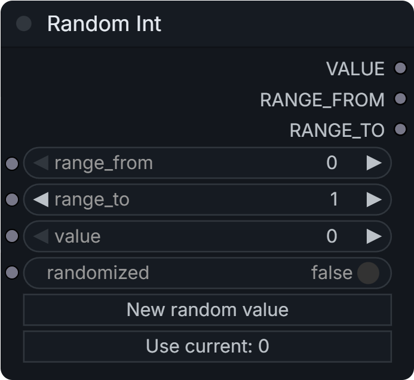
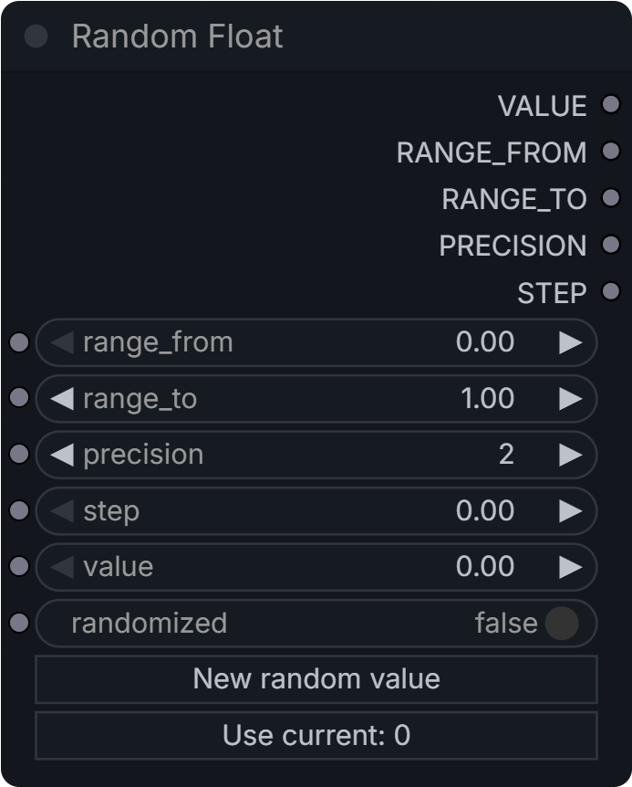

# ComfyUI Random Nodes

Two lightweight nodes that bring proper "roll the dice" randomness to your ComfyUI workflows — without wiring up seeds, primitives, or extra math nodes just to get a random number.

## Random Numbers, Without the Fuss

Need a random integer to pick from a list, or a random float to jitter a value between runs? **Random Int** and **Random Float** drop straight into your workflow and generate a value in the range you set. A single `randomized` toggle controls the behavior: flip it on and the node rolls a new value every run; flip it off and it keeps returning the last one, so you can lock in a result you liked without disconnecting anything.

## Features

- **Type-Focused nodes** — `Random Int` for whole numbers, `Random Float` for decimals with precision and step control.
- **Randomize on demand** — toggle `randomized` to generate a fresh value each run, or freeze it to keep reusing the current one.
- **One-click controls** — "New random value" and "Use current" buttons let you roll or lock a value directly from the node, no extra wiring needed.
- **Fine-grained float control** — set decimal precision and snap results to a step grid (e.g. `0.05` increments).
- **Every input doubles as an output** — all inputs are passed through, so you can wire them into other nodes without splitting your connections or repeating values.
- **Zero dependencies** — pure Python standard library, nothing extra to install.

## Screenshots

  



## Requirements

- ComfyUI with V3 API support (`comfy_api.latest`)
- Python 3.10+

## Quick Start

Clone this repository directly into your ComfyUI `custom_nodes/` folder, then restart ComfyUI:

```bash
cd ComfyUI/custom_nodes
git clone https://github.com/Mistralys/comfyui-random-nodes.git
```

Once ComfyUI restarts, find the nodes by right-clicking the canvas and selecting **Add Node → random**, then pick **Random Int** or **Random Float**. Click **New random value** to roll, or **Use current** to keep what you've got.

## Learn More

| Resource | Description |
|----------|-------------|
| [Project Manifest](docs/agents/project-manifest/README.md) | Technical reference: node schemas, data flow, and design decisions |
| [changelog.md](changelog.md) | Version history and notable changes |
| [LICENSE](LICENSE) | MIT license |
