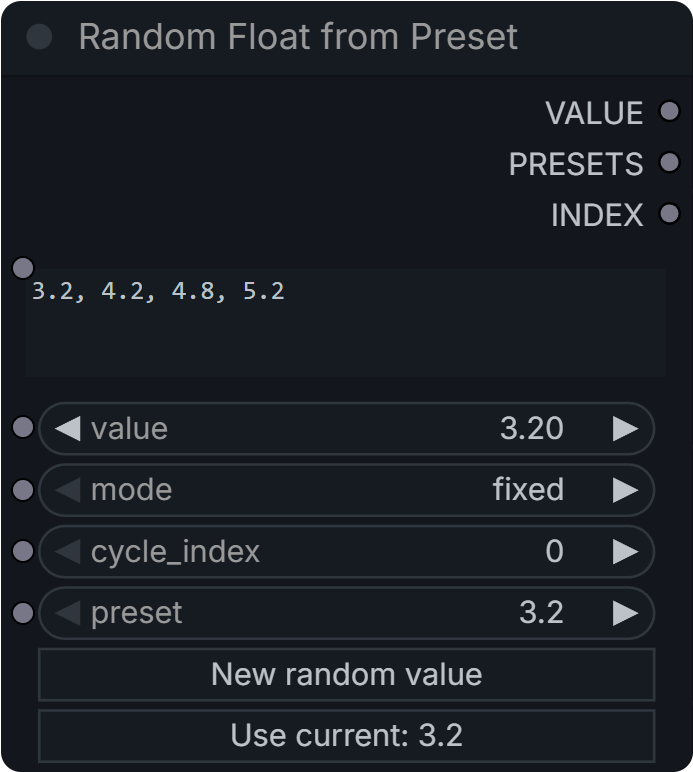

# ComfyUI Random Nodes

Small, stable nodes for generating random numbers in ComfyUI workflows.

## What It Is

Three nodes for when a workflow needs a random integer or float: **Random Int**, **Random Float** and **Random Float from Preset**. You set a range (or a list of presets) and the node produces a value, with no seed or math nodes to wire up. A `randomized` toggle (a `mode` setting on the preset node) decides whether each run produces a new value or reuses the last one.

## Features

- **Random Int** generates whole numbers within a range.
- **Random Float** generates decimals within a range, with settings for precision and step size (e.g. `0.05` increments).
- **Random Float from Preset** picks from a comma-separated list of values. Its mode can be `fixed`, `random` or `cycle`, which steps through the list in order.
- **Keep a result you like.** Turn `randomized` off to keep reusing the stored value.
- **Roll from the node.** The **New random value** button generates a value and stores it, without queuing a run.
- **Inputs are passed through** as outputs, so you can connect them to other nodes without duplicating values.
- **No extra dependencies.** The nodes use the Python standard library and ComfyUI itself.

## Design Philosophy

These nodes are meant to be stable. Each one does a single job, and that job is not going to grow. Updates are limited to bug fixes and adjustments for changes in ComfyUI, so the setup of existing nodes stays as it is. Workflows that use them can rely on them continuing to work.

## Screenshots

  




## Requirements

- ComfyUI with V3 API support (`comfy_api.latest`)
- Python 3.10+

## Quick Start

Clone this repository directly into your ComfyUI `custom_nodes/` folder, then restart ComfyUI:

```bash
cd ComfyUI/custom_nodes
git clone https://github.com/Mistralys/comfyui-random-nodes.git
```

Once ComfyUI restarts, find the nodes by right-clicking the canvas and selecting **Add Node → random**, then pick one of the three nodes.

## Learn More

| Resource | Description |
|----------|-------------|
| [Project Manifest](docs/agents/project-manifest/README.md) | Technical reference: node schemas, data flow, and design decisions |
| [changelog.md](changelog.md) | Version history and notable changes |
| [LICENSE](LICENSE) | MIT license |
